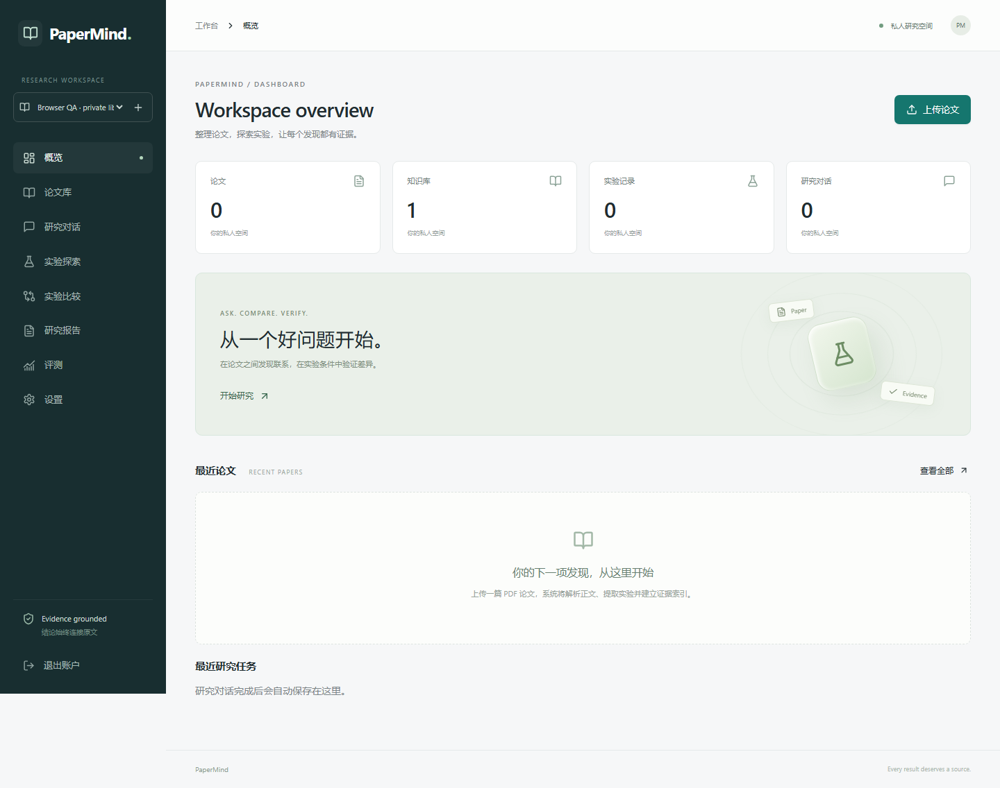

# PaperMind

**Evidence-grounded research intelligence for scientific experiment analysis.**

PaperMind 将论文原文、实验记录和可比性规则连接起来：上传 PDF，检索证据，核对不同论文的实验条件，并检查回答中的引用与数值。核心业务逻辑自主实现，依赖成熟的解析、模型和数据库组件。



## 已实现

- Next.js / React / TypeScript 科研工作台：认证、知识库、论文上传、流式研究对话、实验探索、修订审计、逐字段比较、报告导出、设置和检索评测。
- FastAPI + SQLAlchemy；生产 PostgreSQL、Redis、Celery，开发模式 SQLite 与本地 Qdrant。Alembic 迁移与 OpenAPI。
- Docling 标准 CPU 流水线、PDFium 后端、章节与表格单元格来源、多级表头、原始文档 JSON 保留；解析失败可重试。
- Paper / Evidence / Experiment 三类索引；真实 Dense、BM25、RRF 和 Cross-Encoder。支持本地模型与 OpenAI-compatible API。
- 严格实验 Schema、每字段证据映射、显式单位、单元格对齐、去重、人工修订和版本冲突检测；支持按批次续跑，保留已有 ID 与修订。
- 可配置的确定性可比性引擎。Unknown 不视为相同；不同平均位宽不宣称等预算。
- 有工具、重试、超时、token 和可配置金额预算的 LangGraph 条件图。数值声明由服务端重建，语义声明独立复核。
- 用户、SQL、向量与文件访问隔离；上传类型/大小限制、限速、CORS、统一错误与删除补偿队列。

## 真实验收与限制

详细清单见 [ACCEPTANCE.md](ACCEPTANCE.md)，原始实验见 [evaluation/results](evaluation/results)。当前已执行 **69 项后端测试、2 项浏览器测试**、前端类型检查和生产构建。真实 AWQ 论文完成 Docling → 本地向量 → 真实 DeepSeek RAG → PDF.js 原文渲染；续跑试验确认记录从 18 条增至 24 条且保留原 ID。小型检索试评测包含 **1 篇真实论文、12 道来源锚点问题**；七种系统配置已完成同题真实调用试验。标签由 Agent 整理，**人工核验标注数为 0**。

实验数值和实验条件分别核验：单位须来自原始单元格或指标标签；填写了模型版本、平均位宽等条件不代表这些条件已证实。实验详情支持逐项人工确认并保存审计记录，缺少已核验条件时返回 `INSUFFICIENT_INFORMATION`。结构化检索支持分页，并排除未完成处理的论文。修复说明见 [ADR 0004](docs/decisions/0004-verification-and-recovery-hardening.md)。

生产容器启动、PostgreSQL/Redis/Celery 联合运行及公网 HTTPS 尚未通过本机验收：Docker Desktop 启动失败。Compose 配置校验和 PostgreSQL 离线迁移 SQL 已通过。Langfuse 有实际 SDK 集成，尚无远端服务凭据验证。复杂表格仍可能需要人工审核，不能从单元格对齐通过推断整条实验的全部条件已经正确。

## 本地运行（无需 Docker / GPU）

需要 Python 3.11–3.13、Node 22+、uv。以下命令在项目根目录执行：

```powershell
uv sync --project backend --extra dev --extra pdf --extra local --python 3.12
cd backend
.\.venv\Scripts\alembic upgrade head
.\.venv\Scripts\python -m uvicorn app.main:app --host 127.0.0.1 --port 8000
```

第二个终端：

```powershell
cd frontend
npm ci
npm run build
npm start
```

打开 [http://localhost:3000](http://localhost:3000)，注册并创建知识库。API 文档：[http://localhost:8000/docs](http://localhost:8000/docs)。开发热更新使用 `npm run dev`。

首次运行需下载 Docling、Embedding 和 Reranker 模型，需要网络和数 GB 磁盘空间；CPU 运行不需要 GPU。模型已缓存后可设置 `HF_HUB_OFFLINE=1`。API 模式可减少本地模型负担，Docling 标准解析仍需 CPU 模型。网络受限时可自行配置可信镜像；本次安装使用了清华 PyPI 镜像。

### 配置生成模型

后端工作目录内可放置未跟踪的 `.env`，或在启动进程前设置环境变量：

```powershell
$env:PM_API_KEY = '<your server-side key>'
$env:PM_BASE_URL = 'https://api.openai.com/v1'
$env:PM_CHAT_MODEL = 'your-chat-model'
```

若已有 `DEEPSEEK_API_KEY`，可在根目录运行 `./scripts/dev.ps1 -DeepSeek`。密钥只通过进程环境传递。没有生成模型时，检索仍真实运行，但系统仅展示原文片段，实验提取明确标记 pending；不会输出伪造回答。

Embedding API 使用独立的 `PM_EMBEDDING_API_KEY`、`PM_EMBEDDING_BASE_URL` 和 `PM_EMBEDDING_MODEL`；本地和 API 的 Reranker 配置参见 [.env.example](.env.example)。模型变更后调用 `POST /api/v1/papers/{id}/reindex`，保留人工修订。

## 测试与复现

```powershell
cd backend
.\.venv\Scripts\python -m pytest -q
.\.venv\Scripts\ruff check app tests
cd ../frontend
npm run typecheck
npm run build
npx playwright install chromium --only-shell
# 先启动 API 和前端
npm run test:e2e
```

普通浏览器测试真实调用本地 API。`live-evidence.spec.ts` 需已有真实论文库的短期 JWT 与库 ID（`PM_QA_TOKEN`、`PM_QA_LIBRARY`），否则明确跳过；本次两项均实际运行通过。

真实论文试评测和模型烟测的完整命令见 [docs/evaluation-report.md](docs/evaluation-report.md)。`scripts/live_smoke.py` 会调用已配置的真实模型，产生服务商费用；它不写入密钥和访问令牌。测试中的合成数据与模型替身只在 `backend/tests/` 使用，并有明确标记。

## 部署

```sh
cp .env.example .env
# 设置数据库口令、PM_DATABASE_URL、随机 PM_SECRET_KEY、模型凭据和 SITE_ADDRESS
docker compose config --quiet
docker compose up --build -d
```

只有 Caddy 的 80/443 端口对外开放。完整启动顺序、持久化、备份、恢复、HTTPS 和验收步骤见 [docs/deployment.md](docs/deployment.md)。不要将本地测试成功当作生产容器验收成功。

## 导航

- [架构](docs/architecture.md) · [数据模型](docs/data-model.md) · [API](docs/api.md) · [安全边界](docs/security.md)
- [评测报告](docs/evaluation-report.md) · [架构决策](docs/decisions) · [演示与简历材料](docs/portfolio)
- [持续开发记录](PROGRESS.md) · [原始任务书](REQUIREMENTS.md)

## 来源与独立性

参考 [PaperQA2](https://github.com/Future-House/paper-qa)、[Ai2 ScholarQA](https://github.com/allenai/ai2-scholarqa-lib)、[OpenScholar](https://github.com/AkariAsai/OpenScholar)、[STORM](https://github.com/stanford-oval/storm) 和 [GPT Researcher](https://github.com/assafelovic/gpt-researcher) 的研究产品定位；使用 [Docling](https://github.com/docling-project/docling)、[LangChain/LangGraph](https://docs.langchain.com/oss/python/langgraph/graph-api)、[Qdrant](https://qdrant.tech/documentation/quickstart/) 和 [Langfuse](https://langfuse.com/docs/observability/sdk/instrumentation) 的公开 API。没有整体复制上述应用。实验业务编排、比较规则、证据对齐和评测代码位于本仓库；不宣称学术首创。

本项目代码使用 MIT 许可。第三方代码、模型、论文分别受其自身许可约束；见 [THIRD_PARTY_NOTICES.md](THIRD_PARTY_NOTICES.md)。下载的 AWQ PDF 不随源码分发。
