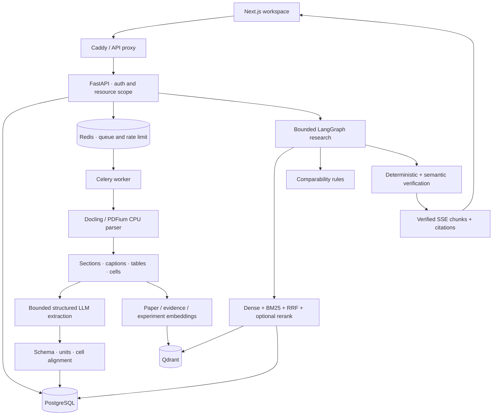
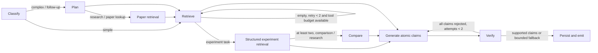

# System architecture

`app/main.py` owns lifecycle, limits and errors. `api/routes.py` owns authenticated resource operations; `ingestion/` owns PDF processing, extraction and indexing. `retrieval.py` owns ranking. `experiments.py` owns normalization, comparison and claim rules. `services/providers.py` owns real model calls. `agents/research.py` owns graph state and conditional transitions; `agents/tools.py` enforces server-bound scope.

Production API processes never parse PDFs synchronously. Upload persists a job and sends it to Celery. The explicit lightweight mode uses FastAPI background tasks, SQLite and local Qdrant; it is for one local API process only. Qdrant local storage cannot be safely shared between a local API process and a separately started worker.

Index names include the embedding backend/model hash. SQL owns authoritative entities. Vector queries include owner/library filters and hits are rehydrated through authorized ready SQL records, so orphan/stale points cannot bypass permissions. Changing embedding models requires reindexing and does not silently reuse incompatible vectors.

BM25 is `rank-bm25` BM25Okapi over scoped evidence, with English tokens and Chinese character/bigram support. The development sparse corpus is capped at 10,000 units per library. Fusion uses `sum(1/(60+rank))` with per-list deduplication. Reranking invokes a real local CrossEncoder or a configured rerank API.

Tables remain complete in authoritative storage. Extraction requests select at most six numeric target cells and retain column headers, row labels, captions and original offsets. Unknown cells/units are not repaired by guessing. PDFium avoids a native resource-path issue observed in this Windows Chinese path. Disabling Docling's secondary cell matching recovered the AWQ table structure; this is a tested configuration choice, not a guarantee for all layouts.

Graph paths:

User/library scope is immutable server context. Documents cannot provide executable tools, SQL or shell commands. Tool names/inputs are allowlisted and Pydantic validated. Tool calls, recursion, retries, tokens, context size and wall-clock duration are bounded. SSE exposes node names and verified output; it does not expose system prompts or raw model reasoning.

Observability stores graph trace, provider token counts, model latency, total latency and estimated dollar cost only if prices are configured. Independent semantic judging is still fallible; it is not deterministic proof. Langfuse generation observations are available when configured. Remote Langfuse export and production distributed services remain unverified in this environment.
