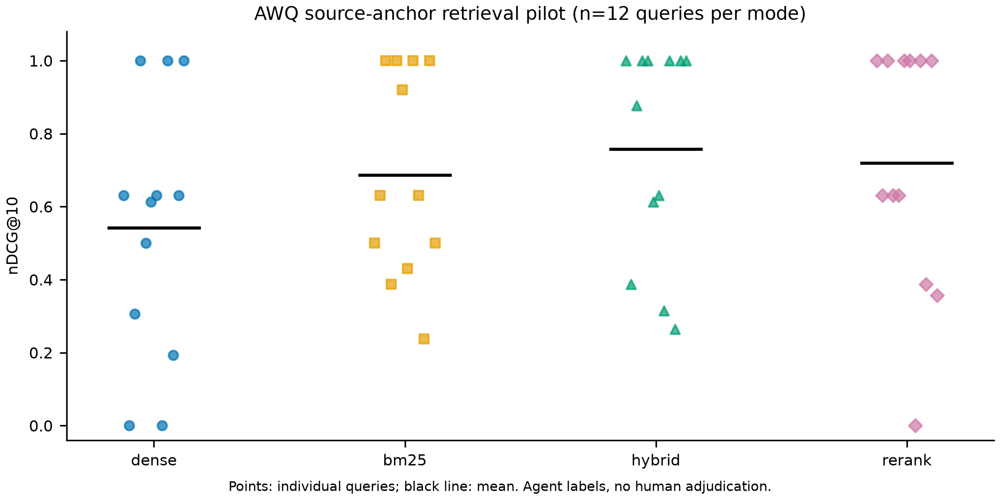
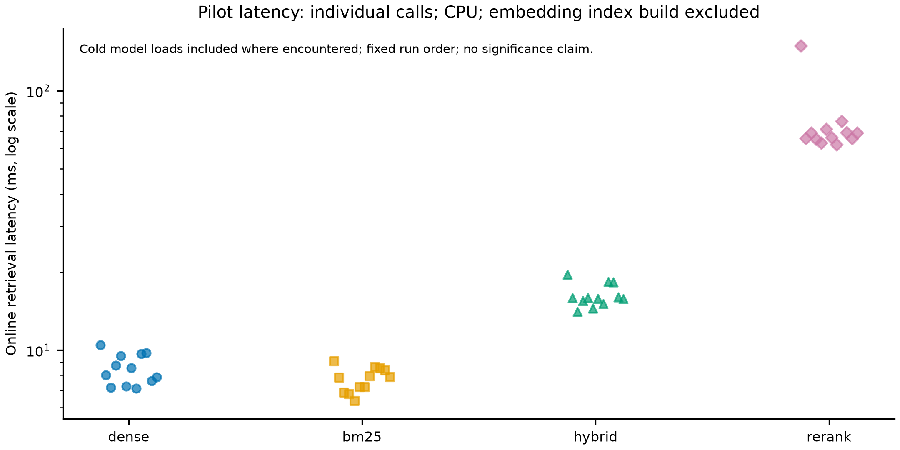
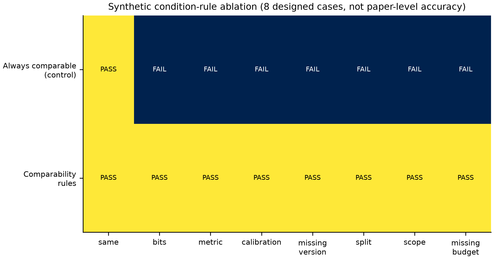
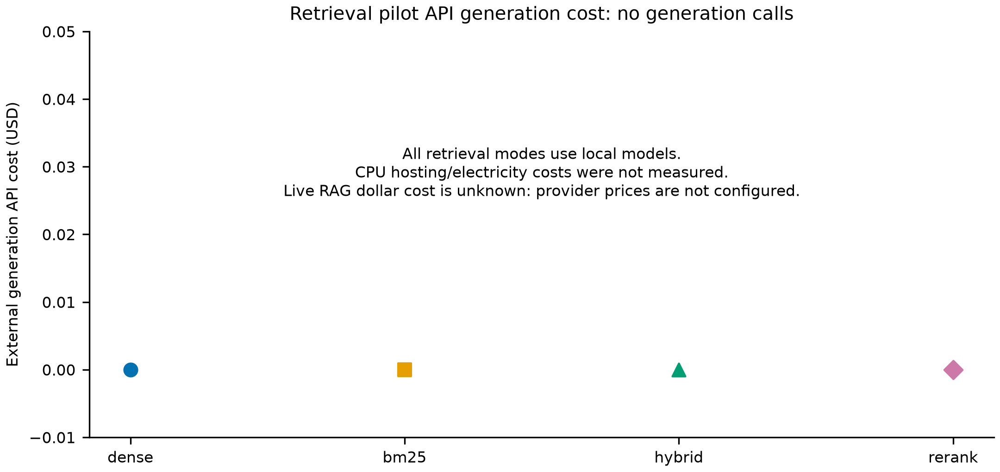
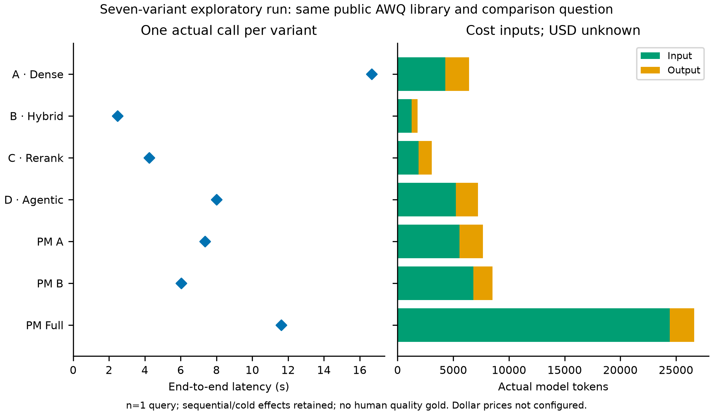

# Evaluation report — 2026-10-19

This is an engineering pilot, not a claim of research novelty or a completed large human benchmark.

## Evidence and population

- Real public source: [AWQ paper, arXiv 2306.00978](https://arxiv.org/abs/2306.00978), downloaded PDF SHA-256 `6e35c8fe7af1f18a5c48dd2524629d859a2013a91d4b3666b554705287a17764`.
- Retrieval pilot: 1 real paper, 46 real text chunks, 12 source-anchor queries, four modes. Pypdf text chunking uses 1800 characters / 200 overlap and is explicitly separate from the application's Docling index.
- Labels: Agent-curated anchors checked against extracted source text, normalized with Unicode NFKC and punctuation/whitespace removal. They are incomplete relevance judgments; other supporting passages may count as nonrelevant. **Human-verified questions/experiments: 0.**
- Rule ablation: 8 designed synthetic comparability cases and 6 synthetic claim cases. These are isolated regression evidence, not real-paper scientific accuracy.
- Real-model smoke: standard Docling + local MiniLM + real CrossEncoder + DeepSeek-compatible generation. All four retrieval paths ran; real file citations returned PDFs. Raw results: `evaluation/results/live-smoke.json`.
- The running HTTP server additionally completed real SSE generation/verification/citation checks with correlated trace IDs (`api-live-smoke.json`). PDF.js source rendering was checked in the browser using nonempty canvas pixels on actual page 4. OpenAlex search and work metadata were fetched from its live API (`openalex-smoke.json`).

## Retrieval results

| Mode | Recall@5 | Recall@10 | MRR | nDCG@10 | Mean online ms |
| --- | ---: | ---: | ---: | ---: | ---: |
| Dense | 0.6667 | 0.7083 | 0.5343 | 0.5422 | 8.4708 |
| BM25 | 0.9583 | 0.9583 | 0.6097 | 0.6864 | 7.7059 |
| Hybrid RRF | 0.8333 | 0.9167 | 0.7562 | 0.7573 | 16.2234 |
| Hybrid + CrossEncoder | 0.7917 | 0.8750 | 0.6858 | 0.7197 | 74.2556 |

These are actual means from the recorded run, not universal rankings. BM25 has the highest labeled Recall@5, while hybrid has the highest MRR/nDCG in this tiny pilot. The reranker did not improve this run. More components do not automatically improve quality.

Latency includes CPU model invocation, with cold loads retained where encountered. Fixed per-query order is dense → BM25 → fusion → rerank; hybrid timings sum these measured components. No randomized repeated trials or confidence intervals were run. Offline embedding time is separately recorded in `pilot.json`; generation is excluded from this retrieval pilot.





## Extraction and source verification

The final real smoke produced **12 structured measurement candidates** that passed deterministic cell/header/entity alignment and **6 textual claims** judged supported by a separate structured model call. The upload was deliberately limited to three extraction batches; one batch reported a schema/value failure and 84 further batches remained beyond the smoke budget. This is partial extraction, not a full-paper extraction recall score.

`realignment.json` reruns the latest deterministic checks against the saved real source cells. An earlier run retained 18 candidates, 17 uniquely aligned and one duplicate-value case unresolved; the final smoke supersedes those counts. Earlier raw output is preserved as `live-smoke-initial.json` only for diagnostics. No extracted candidate is counted as human-reviewed.

A separate resumable-ingestion run (`ingestion-resume-smoke.json`) exercised the updated batch pipeline: 18 initial source-aligned records, still18 after repeating a completed batch, and24 after continuing the next batch, with all original IDs retained. The running HTTP server separately repeated an existing batch with unchanged24 IDs and zero additional LLM calls (`http-resume-smoke.json`). These are real source-processing/idempotency checks, not extraction precision/recall estimates. Reproduce with `live_smoke.py --deepseek --resume --output ingestion-resume-smoke.json`.

Cell alignment does not certify every experiment condition. Missing versions, splits and calibration settings remain null; a checked number does not justify a cross-paper ranking. Real extraction precision/recall/F1 cannot be reported without independent aligned gold records. Metric implementations are provided in `app/evaluation.py` and unit tested, but no real extraction accuracy is invented.

## Designed rule checks and costs

The configurable comparison rules classify all eight designed synthetic cases as expected; an always-COMPARABLE control matches only the one fully identical case. All six synthetic claim cases produce the expected supported/unsupported decision. These checks demonstrate required behaviors, not a measured advantage on unseen papers.



The retrieval pilot makes zero generation API calls, so its external generation cost is zero. CPU/electricity/hosting costs were not measured. The live RAG trace records actual input/output tokens and model latency, but dollar cost is **unknown** because provider prices were not configured. Offline extraction usage is separate from online RAG usage in the job/result. No unknown cost is reported as free.



## Reproduce

From `backend/`, with the installed optional dependencies:

```powershell
# Download the public paper without copying it into the tracked source tree.
.\.venv\Scripts\python -c "import httpx,pathlib;p=pathlib.Path('data/public');p.mkdir(parents=True,exist_ok=True);r=httpx.get('https://arxiv.org/pdf/2306.00978',follow_redirects=True,timeout=60);r.raise_for_status();(p/'awq.pdf').write_bytes(r.content)"
.\.venv\Scripts\python ../evaluation/scripts/benchmark.py
.\.venv\Scripts\python ../evaluation/scripts/plots.py
# Real provider smoke (requires configured key; invokes paid model)
.\.venv\Scripts\python ../scripts/live_smoke.py --deepseek
.\.venv\Scripts\python ../scripts/revalidate.py
```

For a different provider omit `--deepseek` and set PM model variables. Exact Python dependencies are locked in `backend/uv.lock`; frontend versions in `frontend/package-lock.json`. First-use model downloads require network; use `HF_HUB_OFFLINE=1` only after caching.

Results: `pilot.json`, `retrieval.csv`, `comparability.csv`, `claims.csv`, `live-smoke.json`, `realignment.json`, `agent-ablation.json/.csv`, five PNG/SVG charts and `figure-data-profile.json`. Figures display raw points/scope limitations; visual inspection corrected an annotation overlap and the vector heatmap has no embedded bitmap. No statistical-significance claim is made.

## Seven-variant exploratory execution

The same existing public AWQ library and one comparison question were run through all seven configurations, using the same configured model/embedding/temperature. `agent-ablation.json` and `.csv` preserve answers, verification, calls, errors and timings. The final run used 19 model invocations in total and no variant reported a generation error. Baseline output is explicitly marked UNVERIFIED and cannot be enabled through public chat input.

| Variant | End-to-end seconds | Model calls | Input tokens | Output tokens |
| --- | ---: | ---: | ---: | ---: |
| A: Dense | 16.674 | 2 | 4299 | 2110 |
| B: Hybrid | 2.467 | 1 | 1266 | 537 |
| C: Rerank | 4.251 | 1 | 1896 | 1177 |
| D: Agentic | 8.004 | 3 | 5237 | 1988 |
| PaperMind A | 7.362 | 2 | 5550 | 2103 |
| PaperMind B | 6.027 | 2 | 6809 | 1709 |
| PaperMind Full | 11.625 | 8 | 24427 | 2191 |

These are one-query sequential observations with cold/retry effects, not reliable average latency rankings. Dollar cost and answer-quality accuracy remain null because no prices/independent answer gold labels were supplied. Input/output counts include measured schema-repair calls. Comparing this trial's timings with the retrieval-only pilot would mix different workloads.



Reproduce with `python ../evaluation/scripts/agent_ablation.py --deepseek` from backend. It invokes the real provider and writes incremental results. An initial failed trial is separately retained as `agent-ablation-initial.json`; context projection and bounded schema repair corrected those observed failures.

## Remaining evaluation work

An additional real HTTP comparison request exercised generation, verification and conversation persistence after the seven-variant pilot. It returned 10 pairs: five `INSUFFICIENT_INFORMATION` and five `NOT_COMPARABLE`, with three model calls and no errors. Persisted message details were read back and matched the response, including precision-preserving Decimal conditions. The raw response is `evaluation/results/api-comparison-smoke.json`. This is an integration check, not an independently labeled quality benchmark.

The target 30 papers / 150 human-verified experiments / 100 questions is not complete. Independent annotation, field-level extraction gold data, cross-paper semantic QA adjudication, multi-paper comparison cases, randomized latency repetitions and a full seven-variant end-to-end **quality** ablation remain needed. The seven configurations have been executed, but this does not supply missing quality labels. Public deployment/service integration checks are separate from these results and remain blocked by Docker startup.
